<p align="center"></p>

<h1 align="center">Elio</h1>

**A fast, free and open-source terminal and SSH client for Windows, macOS, Linux, iOS and Android.**

Elio is one native app on every platform. There is no Electron and no web view inside it: the terminal is drawn straight to the GPU, starts in a fraction of a second and stays responsive while a server floods it with output. Your servers, keys and snippets follow you between devices with end-to-end encrypted sync, and computers behind a router or firewall are one click away without opening a port.

Website: [elio.sh](https://elio.sh)

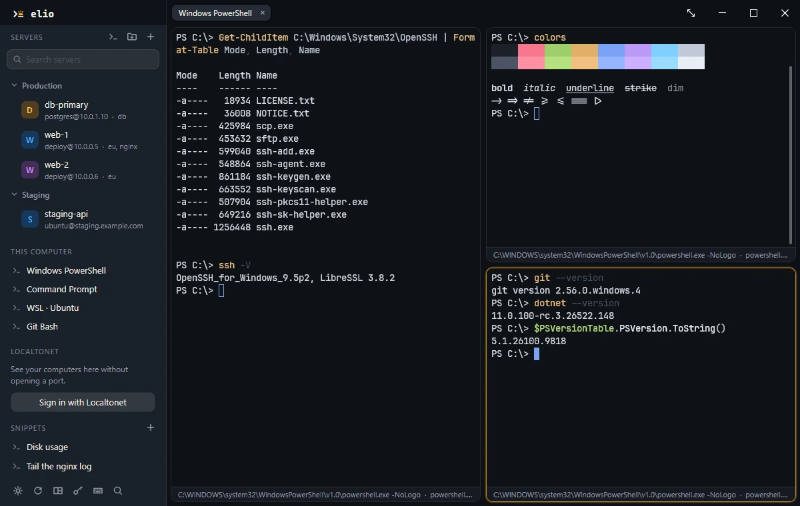

## Contents

- [Why Elio](#why-elio)
- [Getting started](#getting-started)
- [Features](#features): [Terminal](#terminal) · [Connections](#connections) · [Servers](#servers) · [Many servers at once](#many-servers-at-once) · [Files](#files) · [Sharing a terminal](#sharing-a-terminal) · [Sync](#sync) · [Localtonet](#localtonet-optional) · [AI tools](#for-ai-tools) · [Plugins](#plugins) · [Languages](#languages) · [On a phone](#on-a-phone)
- [Keyboard shortcuts](#keyboard-shortcuts)
- [Security](#security)
- [Building from source](#building-from-source)
- [Running your own sync server](#running-your-own-sync-server)
- [The website](#the-website)
- [Repository layout](#repository-layout)
- [Contributing](#contributing) · [License](#license) · [Acknowledgements](#acknowledgements)

## Why Elio

- **It feels instant.** The terminal engine is [libghostty-vt](https://ghostty.org), rendered with Skia and HarfBuzz. Output is pulled from the connection only as fast as the screen can take it, so `cat` on a huge file never freezes the window and Ctrl+C still answers at once.
- **Sync is free and private.** Everything is encrypted on your device before it leaves. The sync server only ever stores ciphertext, and it is open source too: run your own with one Docker command.
- **No ports to open.** Sign in with a [Localtonet](https://localtonet.com) account and your devices appear in the sidebar. Connections to them are end to end, even when both sides are behind NAT. This is optional: Elio works fully without it.
- **Nothing is held back.** No paid tier inside the app, no account needed to use it, no telemetry.

## Getting started

**Get Elio.** Builds for Windows, macOS, Linux and Android are on the [releases page](https://github.com/localtonet/elio/releases/latest), each with its SHA-256 in `SHA256SUMS`. There is no build for iOS there yet: it has to be built and signed with your own Apple account. To build it yourself, see [Building from source](#building-from-source).

**First run.** The window opens with the server list on the left and four ways to begin in the middle: **Local shell**, **Add server**, **Import OpenSSH config** and **Command palette**.

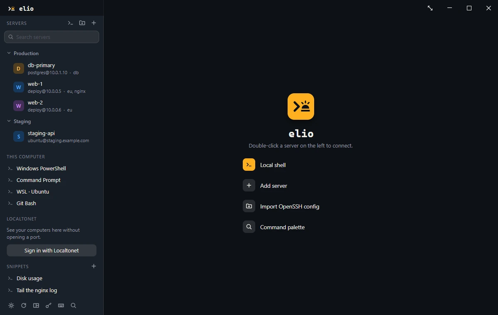

**Add a server.** Press **+** at the top of the sidebar (or run **Add server** from the palette). Choose the type (SSH, Telnet, serial port or a local command), give it a name, an address and a user name, and optionally a private key file, a group and tags. **Advanced** holds the SSH agent, agent and X11 forwarding, Mosh, automatic reconnect, jump hosts, port forwards, a login script and a remote command. If you already have servers in `~/.ssh/config` or PuTTY, import them instead.

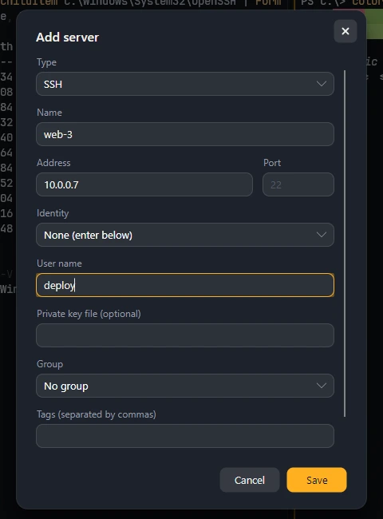

**Connect.** Double-click a server in the sidebar, or press `Ctrl+Shift+T` (**Connect to a server**) and type a few letters of its name. The first time, Elio shows the server's host key and asks you to trust it. A password you type can be stored in the encrypted vault. `Ctrl+Shift+L` opens a local shell.

**The command palette.** `Ctrl+Shift+P` lists every command, your snippets, plugin commands, servers and local shells in one searchable list. Everything described below can be reached from it.

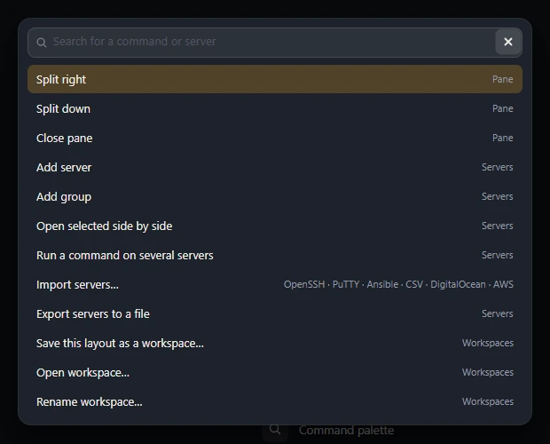

**Settings.** The six buttons at the bottom of the sidebar open **Settings** (the gear), **Sync**, **Workspaces**, the **Keychain**, **Keyboard shortcuts** and the **Command palette**. Settings also opens with `Ctrl` + `,`.

On macOS the shortcuts in this document use `Cmd` in place of `Ctrl`, except for switching tabs.

## Features

### Terminal

**Tabs, panes and windows**

- Tabs and nested split panes. **Split right** (`Ctrl+Shift+D`) and **Split down** (`Ctrl+Shift+E`) divide the active pane, and the panes of a row or column share the space evenly however many times you split.
- A close button appears in a pane's top corner while the pointer is over it; **Close pane** is `Ctrl+Shift+W`. **Zoom pane in / out** (`Ctrl+Shift+M`) lets one pane fill the tab for a while.
- Drag a tab along the strip to reorder it, or out of it to give it a window of its own without dropping the connection (also **Move to new window** in the tab's menu). **Show beside the current tab** and **Show below the current tab** fold any tab into another as a split.
- Right-click a tab to rename it, give it a color, pin it, or close the others. **Reopen closed tab** is `Ctrl+Shift+Z` and **Last used tab** is `Ctrl+Shift+O`.
- Session restore: tabs, panes and their sizes come back after a restart (**Restore tabs at startup** in Settings).
- A split opens in the folder the first pane is in, and a status line under every pane shows what is running there and the terminal's size.

**Look**

- More than 200 color themes built in. With **Switch theme when the system goes light or dark** the terminal changes between two themes of your choice along with the operating system.
- A dark and a light interface (**Light interface** in Settings), independent of the terminal's theme.
- Font size, ligatures, emoji and complex scripts; JetBrains Mono ships with the app so it looks the same everywhere.
- Keyword highlighting: list a color and a word per line under **Text to highlight** in Settings.

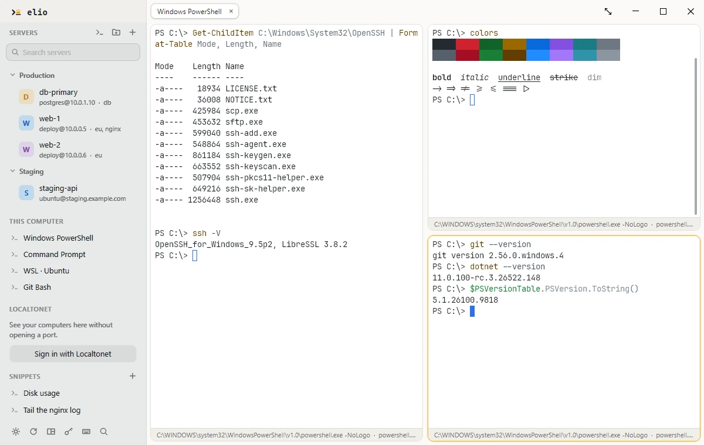

**Finding and reading output**

- **Find in output** (`Ctrl+Shift+F`) searches everything a terminal has printed, history included, as plain text or as a regular expression, with every match on screen marked. Enter goes to the older match, Shift+Enter to the newer one.
- A scrollbar for the history that stays out of the way until there is something to scroll. Dragging a selection past the edge keeps scrolling.
- **Shell marks.** In a shell that marks its commands (OSC 133), **Go to the previous command** and **Go to the next command** (`Ctrl+Shift+Up` / `Ctrl+Shift+Down`) jump from prompt to prompt, and **Copy the last command's output** (`Ctrl+Shift+Y`) copies a whole result. The palette entry **Mark commands in this shell (bash, zsh, PowerShell)** turns marking on for the shell in front, with nothing to install.
- **Save output / stop** writes a pane's output to a file as it arrives. **Clear screen and history** is `Ctrl+Shift+Delete`.
- Ctrl+click opens a web address.

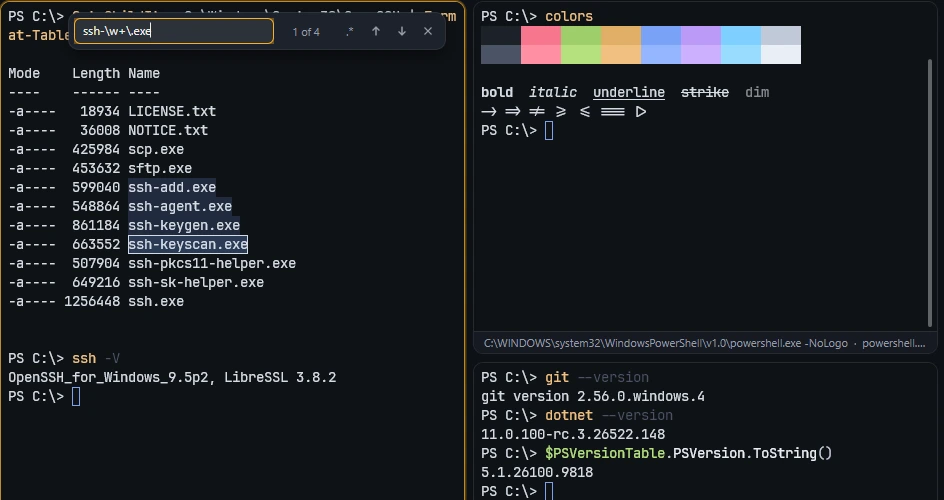

**Typing less**

- **Command suggestions.** While you type, a short list opens under the cursor and the best match is shown dimmed after it. The right arrow accepts, Alt+Up and Alt+Down choose another. Suggestions come from the commands you ran before on that server, from the shell's own history file (and the server's, read once over SSH), and from a set of common commands; what you typed may match in the middle of a command, not only at its start. It can be turned off in Settings.
- **Command history** (`Ctrl+Shift+H`) opens a searchable window of everything you have entered; picking a line sends it to the terminal.
- Copy on select, paste with right click, paste with the middle button, and a warning before a multi-line paste runs.
- Dropping files on a terminal types their paths, safely quoted for the shell in it.

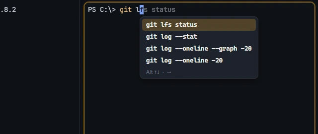

**Pictures**

- Programs that speak the Kitty graphics protocol can show images, plots, thumbnails and animations right in the output.
- **Take a picture of this terminal** (`Ctrl+Shift+S`, or the pane's right-click menu) saves a sharp PNG of the pane to `Pictures\Elio`, puts it on the clipboard and shows a preview with buttons to copy it again or open its folder.

**Tabs that keep you informed**

- A tab shows what happened while you were elsewhere: a bell, a notification from the running program, a finished task, or its progress as a bar along the tab. On Windows the taskbar button flashes when that happens while you are in another program.
- Tabs name the AI tool running in them: Claude Code, Codex, Gemini, Copilot, Aider or Cursor, found by looking at what the shell is running.
- A shell working inside a git repository carries the repository's name on its tab. **Group tabs by repository** puts tabs of the same repository side by side, and **Keep tabs of the same repository together** in Settings keeps them that way.

**The window**

- **Single instance.** Starting Elio a second time opens a new tab in the window that is already running.
- **Summon key (Windows).** Set a key in Settings and it shows or hides the window from anywhere; optionally the window drops down from the top of the screen. With a summon key set, Elio also sits in the system tray.
- **Shells that outlive the window.** With **Keep local shells running when Elio closes, and pick them up again**, local shells run in a small background process. Closing Elio, or replacing it with a newer version, leaves them running for the next window to pick up exactly where they were.
- **Portable mode.** Create a folder named `data` beside the program and Elio keeps everything in it: settings, servers, downloads and logs. Carry it on a USB drive and nothing is left behind on the computer you plug it into. Saved passwords stay locked to the account that stored them, so another computer asks for them again.

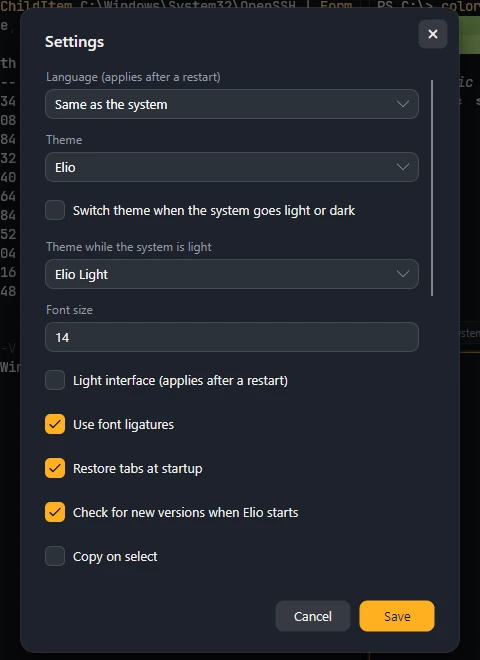

### Connections

**SSH**

- Passwords, Ed25519, ECDSA and RSA keys, encrypted keys, OpenSSH certificates, the OpenSSH agent and Pageant (**Use the keys in the SSH agent**).
- **FIDO2 security keys**: log in with a key that never leaves the hardware. On Windows Elio talks to the key through Windows itself; elsewhere such keys work through the SSH agent.
- Any number of **jump hosts**, each verified on its own. Name them in order under **Jump hosts** in the server's Advanced section.
- **Through a proxy**: SOCKS5 or HTTP CONNECT, with a user name and password if the proxy wants them, under **Connect through** in the server's Advanced section. The server's name goes to the proxy as you typed it, so names only the proxy can look up work. With jump hosts, the proxy leads to the first of them.
- **Local, remote and dynamic (SOCKS5) port forwarding**, one per line under **Port forwards**: `L 8080:localhost:80`, `R 9000:localhost:3000`, `D 1080`. An address to listen on goes in front, and an IPv6 address is written in brackets: `L [::1]:8080:localhost:80`.
- **Agent forwarding**, so `git` and `ssh` on the server can use the keys on your computer without those keys ever being copied there.
- **X11 forwarding**: graphical programs on the server open their windows on your screen. The server is only ever given a throwaway cookie, never the real one.
- A **login script** typed line by line after connecting, or a **remote command** that runs instead of the shell.

**Mosh.** A shell that survives a sleeping laptop, a train tunnel and a change of network. Elio speaks the protocol itself, so nothing needs installing on your side; the server needs `mosh-server`. Tick **Use Mosh** on the server.

**tmux, natively.** Run `tmux -CC` (or `tmux -CC attach`) on a server and its windows become Elio tabs and its panes Elio panes, with Elio's own scrolling, selection and splits. Detach, and they are waiting when you attach again from anywhere. This works over SSH and Telnet and in local shells on macOS and Linux; a local shell on Windows goes through the Windows console, which tmux cannot talk through.

**Local shells.** Found automatically and listed under **This computer** in the sidebar: PowerShell, Command Prompt, WSL distributions, Git Bash, Cygwin, MSYS2 and Cmder on Windows; your login shell and the ones in `/etc/shells` elsewhere. A server of type local is a **profile**: your own command, starting folder and environment variables.

**Docker containers.** **Docker containers** in the palette lists the containers running on this computer and opens a shell in the one you pick.

**Telnet**, with terminal type and window size negotiation.

**Serial ports**, with baud rate, data bits, parity, stop bits and flow control, line-ending conversion, a hex dump view and **Send hex** in the pane's menu.

**When a link drops.** With **Reconnect automatically if the connection drops** Elio retries on its own. When a connection will not come up, **Diagnose connection** checks it step by step (name lookup, the TCP connection, the SSH banner) and says where it stops.

### Servers

- A server library with nested groups, tags and search. Right-click a group to add a group inside it, edit it, open all of its servers or run a command on them.
- **Group defaults.** A group can say what its servers connect with: an identity, a user name, a port, jump hosts, a proxy, the SSH agent, Mosh. A server uses them wherever it sets nothing of its own, groups inside the group inherit them, and the nearest one wins. The server form shows what applies and which group it comes from.
- **The keychain.** An **identity** is a user name with a password or a private key, saved once under **Keychain** (in the sidebar and the palette) and picked on any number of servers or groups. Change it there and every one of them follows. The key is kept in the vault as text, not as a path to a file, so it reaches your other devices through sync.
- **Generate key** in the keychain makes an Ed25519, ECDSA P-256 or RSA 4096 key, with a passphrase if you want one, and shows the public key to copy. **Install on a server…** logs in to the servers you tick the way they log in today, adds the public key to `~/.ssh/authorized_keys` unless it is there already, and then offers to switch those servers to the new identity. A server whose host key is not known yet is left alone.
- **Import servers…** in the palette brings servers in from wherever they already are, and importing twice adds nothing twice:
  - **OpenSSH config** reads `~/.ssh/config`, including `Include`, `ProxyJump`, forwards and `RemoteCommand`, and **PuTTY sessions** brings in what PuTTY has saved.
  - **An Ansible inventory**, in the INI form or the usual YAML layout: `ansible_host`, `ansible_user`, `ansible_port` and `ansible_ssh_private_key_file` are read, ranges such as `web[01:03].example.com` are expanded, and groups become groups, nested as their `children` are. The YAML reader is deliberately small: a file that uses lists, anchors or anything else it does not read is refused with the line number rather than half understood.
  - **A CSV or TSV file** with a header row: name, host, port, user, group and tags, under the names a spreadsheet is likely to give them.
  - **DigitalOcean** droplets, with an API token, and running **AWS EC2** instances of one region, with an access key. The credentials are asked for each time and go to the provider only; tick **Remember in the vault** to keep them there. Both were written against the providers' documentation and have not yet been tried on real accounts. Azure is not there yet, because it needs an app registered with Microsoft first.
- **Export servers to a file** and **Import servers from a file** move a library between computers or to a colleague. Passwords and private keys are never in the file: an identity arrives with its name, user name and public key, and an imported server is never attached to an identity that was already here.
- **Host key pinning.** A server's key is shown on first connection, and a changed key stops the connection before any credential is sent.
- **The vault.** Passwords and passphrases live in an encrypted vault whose key is held by the operating system. On Windows it can also be put behind Windows Hello (**Ask for Windows Hello before saved passwords are used**).

### Many servers at once

- **Open a group side by side.** Right-click a group and choose **Open all side by side**, or Ctrl+click several servers and choose **Open selected side by side**: one tab, one pane each.
- **Workspaces.** **Save this layout as a workspace…** keeps the window's tabs under a name: which servers and local shells, how each tab is split, and the tabs' names, colors and pins. **Open workspace…**, or the workspaces button at the bottom of the sidebar, adds those tabs to the window and connects them as a restored session does. A server deleted since is left out with a note. Workspaces stay on the device they were saved on; they are not synced yet.
- **Drag onto a pane.** Drag a server or a local shell from the sidebar onto a terminal. The half of the pane under the pointer lights up, and the new connection opens on that side: left, right, above or below.
- **Broadcast input** (`Ctrl+Shift+B`): type once, reach every pane in the tab, with a red bar across the top for as long as it is on. A pane can be left out from its right-click menu.
- **Snippets** for the commands you run often live at the bottom of the sidebar and in the palette; choosing one types it into the terminal in front.
- **Run a command on several servers**: tick the servers, enter the command, and read each server's exit code, duration and output in one table. Failed ones can be run again on their own.

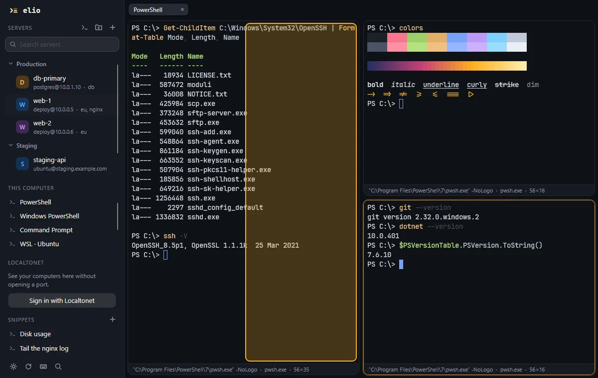

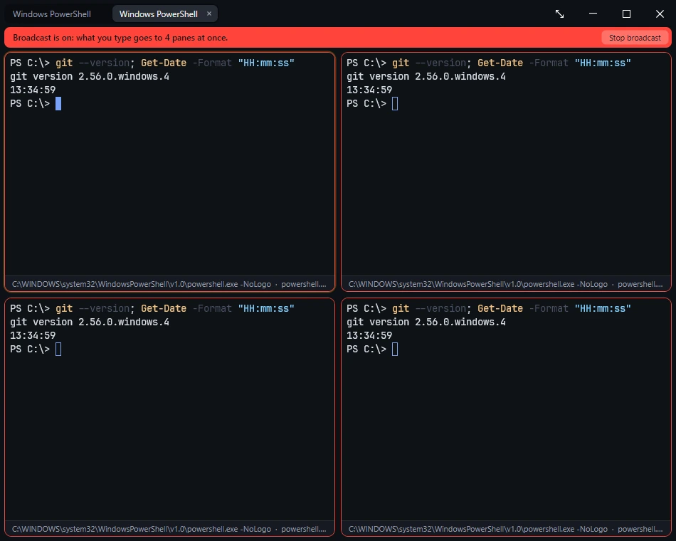

### Files

- A two-pane **SFTP** browser: this computer on one side, the server on the other. Open it with **Open files** on a server, or **Open files beside** to put it next to the terminal you are in.
- **Server to server.** **Open files with another server…** puts a second server on the left instead of this computer, so files and folders copy straight from one to the other. The data streams through Elio as it arrives and is never stored on your disk, with the same queue, resume and safe replace as any other transfer.
- A **transfer queue** with pause, resume, retry, speed and time remaining.
- Transfers as fast as OpenSSH's own `sftp`: requests are streamed without waiting for each answer, over hardware-accelerated AES-GCM.
- Interrupted transfers continue where they stopped, and a half-written file never replaces a good one.
- Drag and drop of files and folders, new folders, rename, delete and permissions.
- **Edit in place**: open a remote file in your editor and every save is uploaded. If the file changed on the server in the meantime, Elio tells you instead of silently replacing it.
- **Zmodem** (`sz` and `rz`) straight in the terminal.

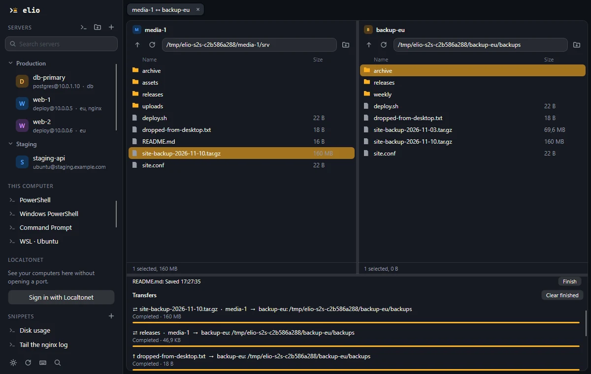

### Sharing a terminal

Any terminal can be shared with a link and a password. Whoever opens the link in their Elio and knows the password sees the same screen live, and can type into it if you allowed that.

- **To share:** choose **Share this terminal / stop** (view only) or **Share and let others type / stop** from the palette or the pane's right-click menu. The link is copied to the clipboard and a password is shown; give the password another way, by phone or in a different chat. The pane's status line shows how many people are watching.
- **To watch:** choose **Watch a shared terminal** from the palette and enter the link and the password.
- The terminal is shared over the internet through the sync server, with no port opened on your computer and no account needed on either side. If the server cannot be reached, nothing is shared unless you then choose **Share on my network**: Elio asks first, and only on a yes listens on this computer's own network address, where anyone on the same network who has the link and the password can connect to it directly.
- Either way the stream is encrypted from end to end with a key made from the password, so the server in between carries bytes it cannot read, and sharing ends the moment you stop it.
- A different relay can be set under **Server that passes shared terminals along** in Settings.

### Sync

Sync keeps your servers, groups, snippets, identities and known host keys the same on every device, and saved passwords and keys too if you leave **Also sync saved passwords** on.

- **End-to-end encrypted.** The key is derived from your password with Argon2id on your device. A recovery key, shown once when sync is started, protects you from a forgotten password. The server stores ciphertext and nothing else.
- **No account needed.** The first device makes a **sync code**; the others take the code and your password.
- **Adding a device takes a code, not the password.** Under **Add another device** the Sync window shows a one-time code and the same thing as a QR code. Type the code on the other device, or on a phone choose **Scan QR code** (the phone's own camera works too), and the device is added without the password being asked: the code carries the key, works once, and lasts ten minutes.
- **Or sign in with Localtonet**, and the account says whose data it is: there is no code to type at all.
- **Changes merge per item**, so editing on two devices at once loses nothing. A device that was switched off catches up the next time it opens.

To turn it on, open **Sync** from the sidebar or the palette. The window asks one question first: **This is my first device**, **I already sync on another device**, or **Sign in with Localtonet first**. The first device chooses a password of at least ten characters and is shown the recovery key once. After that the same window shows the state of sync and offers **Add another device**, **Sync now**, **Change password** and **Turn off on this device**. After signing in with Localtonet, Elio offers to turn sync on for that account. The server address can be your own: see [Running your own sync server](#running-your-own-sync-server).

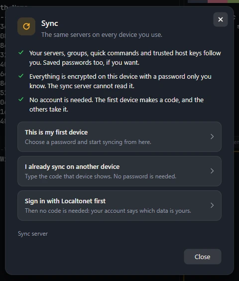

### Localtonet (optional)

[Localtonet](https://localtonet.com) reaches computers behind a router or firewall without opening a port. Elio does everything else on this page without it; signing in only adds your Localtonet devices to the sidebar.

- Run `localtonet --terminal enable` on a computer, press **Sign in with Localtonet** in the sidebar, and approve in the browser after checking that both show the same code. The computer appears in the list with its online state, and connects like any other server, files included.
- **Several accounts** can be signed in at once (**Add another Localtonet account**).
- **Access keys.** Opening a shell on a device takes your approval in the browser each time, or that device's access key. **Get access keys for all devices…** asks Localtonet for a key for every device in one approved step, for one, two, five or ten years, and keeps them in the vault, so connecting no longer asks. A key can also be entered or deleted for a single device from its right-click menu.

### For AI tools

Elio is also a [Model Context Protocol](https://modelcontextprotocol.io) server. Point an AI tool at the command `elio --mcp` and it gets two tools:

| Tool | What it does |
| --- | --- |
| `list_servers` | Lists the servers saved in Elio: name, kind, address, user, group and tags. Never passwords or keys |
| `run_command` | Runs one command over SSH on a saved server and returns its exit code and output |

`run_command` is off until you tick **Let AI tools connected with "elio --mcp" run commands on your servers** in Settings, and then works only on the servers where you have also ticked **AI tools may run commands on this server** (edit the server, under **Advanced**). Even then it only works on servers you have already connected to from Elio yourself, so that their host key is trusted and their credentials are in the vault. A command may run for two minutes, and output beyond 64 KB is cut. Every command that is run is written to `mcp-commands.log` in Elio's data folder, with the time, the server and how it ended.

The tool runs in a process of its own, but the window you have open tells you about it. A line above the terminals says which command ran on which server, and **Show all** (or **Commands run by AI tools** in the palette) opens a column beside the terminals where every command appears as it starts, with its exit code, how long it took and what it printed. For that column the commands and their output are kept in `mcp-activity.jsonl` in the data folder, at most 32 KB for each command and about 1 MB in all; **Clear** in the column deletes the file. The server form says so when you allow a server while the switch in Settings is still off, and can turn that on with it.

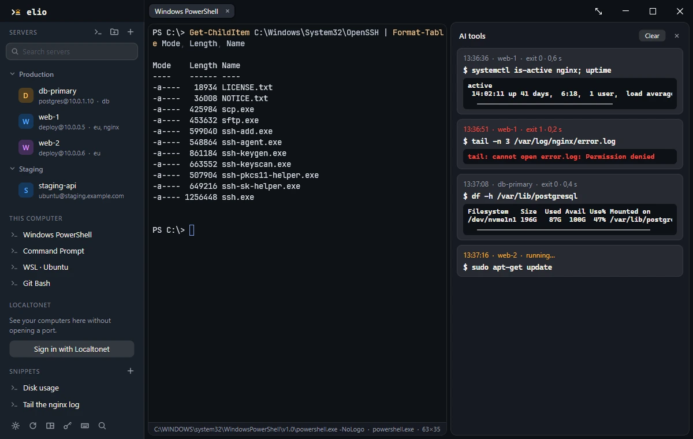

Most tools take a configuration like this:

```json
{
  "mcpServers": {
    "elio": { "command": "elio", "args": ["--mcp"] }
  }
}
```

### Plugins

A plugin is any program that speaks a few JSON messages on its standard input and output, in any language. It adds commands to the palette, and when one runs it can type into the terminal, ask a question, show a note, copy text or open a web page. Plugins never see passwords or keys.

Each plugin is a folder with a `plugin.json` in it, inside `plugins` in Elio's data folder (`%LOCALAPPDATA%\Elio\plugins` on Windows, `data\plugins` in portable mode). Elio asks before it runs a plugin for the first time, and again if its `plugin.json` changes. The protocol is described in [docs/PLUGINS.md](docs/PLUGINS.md), and a working example is in [docs/plugin-example](docs/plugin-example).

### Languages

The interface is available in 20 languages: Arabic, Bengali, Chinese (Simplified), Dutch, English, French, German, Hindi, Indonesian, Italian, Japanese, Korean, Persian, Polish, Portuguese, Russian, Spanish, Turkish, Ukrainian and Vietnamese. Elio follows the language of the operating system, and it can be changed in Settings.

### On a phone

The same app runs on Android and iOS with a layout made for a small screen: the terminal fills it, the server list slides in from the side, and a row of keys above the keyboard adds what a phone keyboard lacks: Esc, Tab, Ctrl, Alt, the arrows and the symbols a shell needs. A finger scrolls the history, and two fingers resize the text. A keyboard button in the corner brings the keyboard up or puts it away.

- **App lock.** **Lock Elio with this device's fingerprint, face or passcode** in Settings asks for it when the app is opened and when it comes back from the background. On Android a locked Elio is also kept out of screenshots and shown blank in the list of recent apps.
- **Scan to sync.** **Scan QR code** in the Sync window reads the code another device shows under **Add another device**, and the phone's own camera app opens the same link.

## Keyboard shortcuts

Every shortcut can be changed under **Keyboard shortcuts** (`Ctrl+Shift+K`, or the keyboard button at the bottom of the sidebar). A shortcut may be a sequence of presses, written with a space between them, such as `Ctrl+K Ctrl+S`. **Restore defaults** brings these back:

| Action | Default |
| --- | --- |
| Command palette | `Ctrl+Shift+P` |
| Connect to a server | `Ctrl+Shift+T` |
| Open local shell | `Ctrl+Shift+L` |
| Split right | `Ctrl+Shift+D` |
| Split down | `Ctrl+Shift+E` |
| Close pane | `Ctrl+Shift+W` |
| Next tab | `Ctrl+Tab` |
| Previous tab | `Ctrl+Shift+Tab` |
| Turn broadcast input on / off | `Ctrl+Shift+B` |
| Find in output | `Ctrl+Shift+F` |
| Reopen closed tab | `Ctrl+Shift+Z` |
| Last used tab | `Ctrl+Shift+O` |
| Zoom pane in / out | `Ctrl+Shift+M` |
| Clear screen and history | `Ctrl+Shift+Delete` |
| Go to the previous command | `Ctrl+Shift+Up` |
| Go to the next command | `Ctrl+Shift+Down` |
| Copy the last command's output | `Ctrl+Shift+Y` |
| Take a picture of this terminal | `Ctrl+Shift+S` |
| Command history | `Ctrl+Shift+H` |
| Larger text | `Ctrl+OemPlus` (the `+` key) |
| Smaller text | `Ctrl+OemMinus` (the `-` key) |
| Reset text size | `Ctrl+D0` (the `0` key) |
| Settings | `Ctrl+OemComma` (the `,` key) |
| Keyboard shortcuts | `Ctrl+Shift+K` |

On macOS, `Cmd` takes the place of `Ctrl` in all of these except **Next tab** and **Previous tab**. Commands without a default key, such as **Group tabs by repository**, are in the palette.

A few keys belong to the terminal itself: the right arrow accepts a suggestion and Alt+Up / Alt+Down choose one, Enter and Shift+Enter move through search matches and Esc closes the search bar, Ctrl+click opens a link, and Ctrl+click in the sidebar selects several servers.

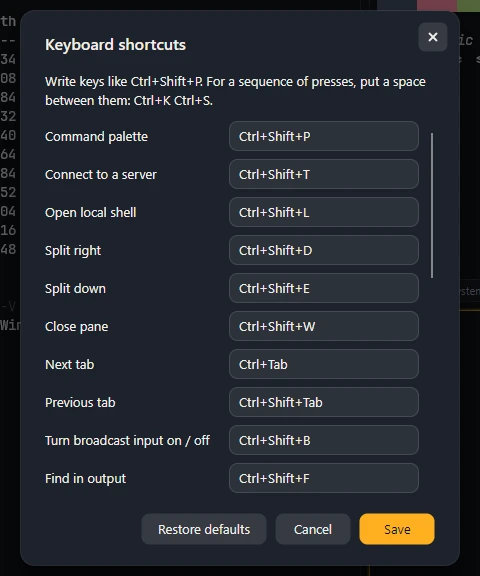

## Security

- The vault is encrypted with AES-GCM and its key is kept by the operating system's own key store.
- On Windows the vault can also be put behind Windows Hello, so saved passwords are only used after a fingerprint, a face or a PIN.
- Sync is end to end encrypted. The server cannot read what it stores, and without the password or the recovery key nobody can.
- A shared terminal is encrypted with a key made from its password. The relay in between sees only ciphertext.
- A server's key is pinned on first use. If it ever changes, Elio stops and asks before sending anything.
- Connections to Localtonet devices go end to end, and the device's key is checked against the one recorded when it was paired.
- The key Elio receives from Localtonet can only list devices and prove your identity to the sync server. It cannot open a shell, and it can be revoked from your Localtonet account at any time.
- Opening a shell on a device takes that device's access key, or your approval in the browser. Elio can fetch an access key for every device in one go, for as long as you choose, and that request too has to be approved in the browser with your second factor. The keys stay in the vault on your computer and can be revoked from each device's page.
- Plugins and AI tools never receive passwords or keys. An AI tool can run commands only where you allowed it twice, in Settings and on the server, and what it ran is shown in the window and written to a log.
- On a phone, Elio can be locked behind the device's fingerprint, face or passcode.
- No telemetry. Passwords and keys are never written to logs.
- The only request Elio makes on its own is a version check: on a computer, at most once a day, it asks GitHub for the latest release and tells you if there is a newer one. Nothing about you or your servers is sent, and **Check for new versions when Elio starts** in Settings turns it off.

Found a security problem? [SECURITY.md](SECURITY.md) says how to report it privately.

## Building from source

Elio targets .NET 10.

### 1. Build the terminal engine

libghostty-vt is built from source by `build/native.sh`. The script pins every version, checks every download against its SHA-256, and leaves the libraries in `native/out/<rid>`. Docker is all it needs:

```bash
docker run --rm -v "$PWD:/src" -w /src ruby:3.3 sh build/native.sh win-x64 linux-x64 linux-arm64
```

Android targets also need the Linux NDK in `ANDROID_NDK_HOME`.

The Apple half is built on a Mac, because linking for macOS and iOS needs Apple's SDK. `build/native-apple.sh` uses the same pinned, checksummed sources and needs only the Xcode command line tools:

```bash
sh build/native-apple.sh osx-arm64 osx-x64 ios
```

### 2. Build and run the app

```bash
dotnet run --project src/Elio.Desktop
```

The whole solution, which also needs the `android` and `ios` workloads:

```bash
dotnet build Elio.sln
```

The tests need no workloads and touch neither the network nor your own Elio data; run them with `dotnet test tests/Elio.Tests`.

A single file that runs without .NET installed, with the terminal engine inside it (`win-x64`, `linux-x64` or `linux-arm64`):

```bash
dotnet publish src/Elio.Desktop -c Release -r win-x64 -o publish/elio
```

On Linux the file needs the libraries a desktop already has: ICU (`libicu`), fontconfig and X11.

On a Mac the same command with `-r osx-arm64` or `-r osx-x64` leaves the program with its libraries beside it, and `build/package-macos.sh` turns that into a signed `Elio.app`:

```bash
dotnet publish src/Elio.Desktop -c Release -r osx-arm64 -o publish/osx
sh build/package-macos.sh 1.0.0 osx-arm64 publish/osx dist
```

The iPhone and iPad app is built on a Mac too, for the simulator or, with a development provisioning profile, for a device:

```bash
dotnet build src/Elio.iOS -c Debug -r iossimulator-arm64
dotnet build src/Elio.iOS -c Release -r ios-arm64 -p:CodesignProvision="<profile name>"
```

A native, ahead-of-time compiled desktop build:

```bash
dotnet publish src/Elio.Desktop -c Release -r win-x64 -p:PublishAot=true -o publish/elio
```

On Windows this needs the Visual Studio C++ build tools.

### Releases

Pushing a tag such as `v1.2.3` runs `.github/workflows/release.yml`, which rebuilds libghostty-vt from source, builds Elio for Windows (x64), Linux (x64 and arm64, each as a tar.gz and a .deb), macOS (Apple silicon and Intel, as `Elio.app`) and Android, and publishes them on the releases page with a `SHA256SUMS` file. A tag with a hyphen, such as `v1.2.3-beta.1`, becomes a pre-release. The Android package is signed with the key in the repository's `ANDROID_KEYSTORE_*` secrets, which the workflow file describes.

### Environment variables

| Variable | Effect |
| --- | --- |
| `ELIO_DATA_DIR` | Settings, the vault, downloads and logs are kept in this folder |
| `ELIO_LOCALTONET_URL` | The Localtonet address. Defaults to `https://localtonet.com` |
| `ELIO_SYNC_URL` | The sync server offered when sync is first set up |

## Running your own sync server

The server stores only encrypted data in SQLite; the key that decrypts it never reaches it. An app says whose data it is with a sync code: a long random key it made up on the first device, which you type into the others. No account is needed. Signed in with Localtonet, the account says it instead, with a short-lived proof issued for that server's address and nobody else's, and there is no code to carry.

From the repository root:

```bash
docker build -f server/Elio.SyncServer/Dockerfile -t elio-sync .
```

```bash
docker run -d -p 8080:8080 -v elio-sync:/data -e Sync__PublicUrl=https://sync.example.com elio-sync
```

The container listens on plain HTTP on port 8080, so put a reverse proxy with HTTPS in front of it. Then enter the server's address in Elio's Sync window.

**Behind a proxy**, set `Sync__BehindProxy=true` so that request limits count each visitor rather than the proxy; without it everyone shares one allowance, and the server says so in its log when it sees the proxy's header. Also set `Sync__TrustedProxies` to the proxy's address or network, for example `172.17.0.1` or `172.16.0.0/12`, several separated by commas. Then `X-Forwarded-For` is believed only from there. Left empty, it is believed from anyone, so a caller who can reach the container directly can claim any address and get around every limit: in that case make sure nothing reaches the container except through the proxy.

**Disk.** A sync code costs nothing to make up, so the server keeps at most `Sync__MaxVaults` stores of data and refuses to start new ones beyond that. Set `Sync__VaultIdleDays` to have stores that no device has read or written for that many days removed; a device that returns later starts sync again from its own copy.

**Shared terminals.** The same server also passes shared terminals along (turn it off with `Sync__ShareRelay=false`). It only ever sees bytes already encrypted between the two ends. This uses WebSockets on `/v1/share/host` and `/v1/share/join/{id}`, so the reverse proxy must forward the upgrade: for nginx, `proxy_http_version 1.1;`, `proxy_set_header Upgrade $http_upgrade;`, `proxy_set_header Connection "upgrade";`, and turn buffering off for those paths. Caddy and Traefik do this on their own. Set the proxy's read timeout above 30 seconds (for example `proxy_read_timeout 120s;`): the server and the apps send a keep-alive every 30 seconds, so a quiet terminal stays connected as long as the timeout is longer than that. The address of a viewer's request ends in the room id; the server keeps it out of its own log, and you may want to keep it out of the proxy's access log too.

| Setting | Meaning |
| --- | --- |
| `Sync__PublicUrl` | Required. The address clients use. Identity proofs are accepted for this address only |
| `Sync__Localtonet` | Where proofs are verified. Defaults to `https://localtonet.com`; leave empty to turn Localtonet sign-in off |
| `Sync__StaticTokens` | For running without Localtonet: `token=account` pairs separated by semicolons |
| `Sync__Database` | The SQLite file. `/data/sync.db` in the container |
| `Sync__MaxBytes` | The most data one account may store. Defaults to 4 MB |
| `Sync__MaxVaults` | How many stores of data the server keeps, for everyone together. Defaults to 100000 |
| `Sync__VaultIdleDays` | Stores not read or written for this many days are removed. Defaults to 0, which keeps them for ever |
| `Sync__BehindProxy` | `true` when a reverse proxy is in front and passes `X-Forwarded-For` |
| `Sync__TrustedProxies` | The proxy's addresses or networks, separated by commas. Only these are believed about who a request came from. Empty believes anyone |
| `Sync__AccountsWithoutSignIn` | `false` takes only signed-in accounts and static tokens, no sync codes |
| `Sync__NewAccountsPerDay` | How many new stores one address may start in a day with sync codes. Defaults to 10 |
| `Sync__ShareRelay` | `false` turns off passing shared terminals along |
| `Sync__ShareWithoutAccount` | `false` lets only signed-in accounts share terminals through the server |
| `Sync__ShareRoomsPerAccount` | How many terminals one account may share at a time. Defaults to 4 |
| `Sync__ShareViewersPerRoom` | How many people may watch one shared terminal at a time. Defaults to 16 |

## The website

The site at [elio.sh](https://elio.sh) lives in `web/Elio.Web`. It is plain static files with no build step, no dependencies and no tracking. To preview it:

```bash
dotnet run --project web/Elio.Web --urls http://127.0.0.1:5199
```

Publishing it is described in [web/README.md](web/README.md).

## Repository layout

| Folder | Contents |
| --- | --- |
| `src/Elio.Terminal` | The engine binding, terminal sessions and Zmodem |
| `src/Elio.Connections` | SSH, SFTP, the transfer queue, local shells, Telnet and serial ports |
| `src/Elio.Core` | The server library, vault, settings and translations |
| `src/Elio.Localtonet` | Localtonet sign-in, the device list and connections to devices |
| `src/Elio.Sync` | The end-to-end encrypted sync client |
| `src/Elio.UI` | The interface, shared by every platform |
| `src/Elio.Desktop`, `src/Elio.Android`, `src/Elio.iOS` | The platform heads |
| `server/Elio.SyncServer` | The sync server |
| `web/Elio.Web` | The website |
| `vendor/SSH.NET` | Elio's copy of SSH.NET, with the changes listed in its README |
| `docs` | The plugin protocol, an example plugin and the pictures on this page |
| `build` | Scripts that build libghostty-vt and package the Linux and macOS apps |

## Contributing

Issues and pull requests are welcome. Translations are plain JSON files in `src/Elio.Core/Languages`, one per language, mapping the English text to the translated one; corrections from native speakers are especially appreciated.

## License

Elio is licensed under the [Apache License 2.0](LICENSE). The bundled JetBrains Mono fonts are under the [SIL Open Font License 1.1](src/Elio.UI/Fonts/OFL.txt).

## Acknowledgements

Elio stands on [libghostty-vt](https://ghostty.org), [Avalonia](https://avaloniaui.net), [SkiaSharp](https://github.com/mono/SkiaSharp), [SSH.NET](https://github.com/sshnet/SSH.NET) and [JetBrains Mono](https://www.jetbrains.com/lp/mono/).
